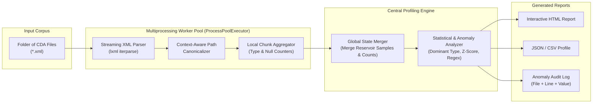
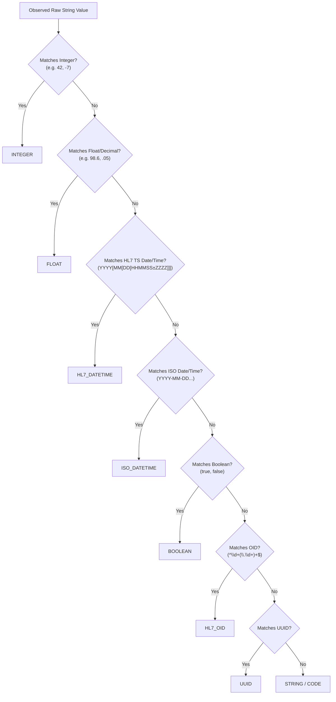

# CDA Statistical Data Profiler — Architecture & Design

## 1. Executive Summary

This document outlines the design of a Python CLI and library (`cda-profiler`) that scans a directory of **HL7 Clinical Document Architecture (CDA / C-CDA)** XML files (or general structured documents) and produces a statistical data quality profile. 

Rather than validating against a rigid, pre-defined schema that simply fails on the first error, the profiler performs **bottom-up empirical discovery** across the corpus to identify:
1. **Missingness & Completeness**: Fields that are omitted, empty, populated with HL7 `nullFlavor` attributes (`NI`, `UNK`, `NA`, `OTH`), or filled with placeholder strings (`"N/A"`, `"UNKNOWN"`, `"00000"`).
2. **Apparent Data Type & Non-Conforming Members**: Inferring the dominant ("apparent") data type of every element text and attribute across the folder, and isolating minority values that violate that inferred type (e.g., `"Pending"` or `"120/80"` in a field that is $99.2\%$ numeric floats).
3. **Declared vs. Actual Type Mismatches**: Detecting elements where the HL7 `xsi:type` attribute (e.g., `PQ`, `TS`, `INT`, `CD`) contradicts the actual content.
4. **Structural & Format Anomalies**: Inconsistent HL7 timestamp precisions (`YYYYMMDD` vs. `YYYY-MM-DD`), malformed OIDs/UUIDs, and unexpected cardinality spikes.

---

## 2. System Architecture



> [!TIP]
> **Memory-Safe Scaling**: CDA folders often contain tens of thousands of multi-megabyte XML files. By using `lxml.etree.iterparse` inside worker processes and keeping only fixed-size **reservoir samples** of non-conforming values per field, memory usage stays flat ($O(\text{unique paths})$) regardless of whether you scan $100$ or $1,000,000$ documents.

---

## 3. Core Design Concepts

### 3.1 Context-Aware Path Canonicalization
In raw XML, a naive XPath like `/ClinicalDocument/component/structuredBody/component/section/entry/act/code/@code` merges completely unrelated clinical domains (e.g., *Allergies*, *Medications*, *Results*, and *Vital Signs* all share `<section>` and `<entry>`).

To prevent cross-contaminating field statistics, the **Path Canonicalizer** supports two simultaneously tracked path modes:
1. **Structural XPath** (Namespace-normalized):
   `/ClinicalDocument/recordTarget/patientRole/patient/birthTime/@value`
2. **Template/Section-Scoped Canonical Path** (for `<section>` and clinical statements):
   Anchors paths using the nearest enclosing HL7 `templateId/@root` or section `code/@code` (LOINC):
   `/ClinicalDocument/section[loinc=8716-3:VitalSigns]/organizer/component/observation[template=2.16.840.1.113883.10.20.22.4.27]/value/@value`

---

### 3.2 Missingness Taxonomy
In CDA documents, a field can be "missing" in four distinct ways. The profiler tracks each bucket separately for every discovered field:

| Missingness Category | Detection Rule | Statistical Impact |
| :--- | :--- | :--- |
| **1. Structurally Absent** | Parent node exists in document, but child element/attribute is omitted (`0` occurrences in doc). | Increases `docs_missing_count`. |
| **2. Empty / Whitespace** | Element or attribute is present (`<addr></addr>` or `value=""`), with no children and no `@nullFlavor`. | Flagged as **Malformed Empty**. |
| **3. Explicit `nullFlavor`** | Element carries `@nullFlavor` (e.g., `UNK`, `NI`, `NA`, `ASKU`, `MSK`, `OTH`). | Tracked in a breakdown histogram per field (`null_flavor_counts`). |
| **4. Implicit / Sentinel Null** | Populated text matches heuristic null tokens: `{"n/a", "null", "none", "unknown", "unk", "-", "99999", "0000-00-00"}`. | Flagged as **Disguised Null** (should have used `@nullFlavor`). |

---

### 3.3 Apparent Data Type Inference & Conformance Engine

Instead of forcing one type per field upfront, every non-null value observed at path $p$ is classified into its **most specific matching primitive type** from a deterministic hierarchy:



#### Type Promotion & Dominant Type Resolution
After aggregating counts across all documents for a field $p$ with $N_{\text{valid}}$ populated values:
1. **Compatible Numeric Promotion**: If a field has both `INTEGER` ($30\%$) and `FLOAT` ($70\%$), `INTEGER` counts are promoted into `FLOAT` (since every integer is a valid float), yielding $100\%$ `FLOAT`.
2. **Apparent Type Determination**:
   Let $T_{\text{dom}}$ be the type with the highest share $s = \frac{\text{count}(T_{\text{dom}})}{N_{\text{valid}}}$.
   - If $s \ge \tau_{\text{type}}$ (configurable threshold, default **$0.80$** or $80\%$) and $T_{\text{dom}} \neq \text{STRING}$, then $T_{\text{dom}}$ is declared the **Apparent Data Type**.
   - Any value with inferred type $T_i \neq T_{\text{dom}}$ (and not promotable to $T_{\text{dom}}$) is flagged as a **Type Non-Conforming Member**.

#### Sub-Type & Pattern Conformance (Within-Type Anomalies)
Even when values share a primary type, the profiler detects secondary conformance issues:
- **`HL7_DATETIME` Precision Drift**: Tracks the distribution of date lengths/formats (e.g., $97\%$ `YYYYMMDD` vs. $2\%$ `YYYY` vs. $1\%$ invalid calendar dates like `20230231` or `18000101`).
- **`STRING` Pattern / Regex Inference**: Every string is converted into a character-class mask (e.g., `"90210-1234"` $\rightarrow$ `99999-9999` / `D{5}-D{4}`). If $\ge 85\%$ of values conform to 1–2 masks (such as US ZIP codes, SSNs, phone numbers, or LOINC codes), values matching rare masks are flagged as **Pattern Outliers**.
- **`xsi:type` Contradictions**: If an element specifies `xsi:type="PQ"` (Physical Quantity), `@value` must be numeric (`INTEGER` or `FLOAT`). If `@value="trace"` or `"+1"` without `@nullFlavor`, it is flagged as an **HL7 Schema Type Violation**.
- **Numeric Outliers**: Uses Welford's online algorithm to compute running mean $\mu$, standard deviation $\sigma$, min, max, and approximate quantiles (or IQR) to flag extreme numerical values (e.g., body temperature of `986` instead of `98.6`).

---

## 4. Proposed Project Structure

```text
cda_profiler/
├── pyproject.toml
├── README.md
├── src/
│   └── cda_profiler/
│       ├── __init__.py
│       ├── cli.py                 # CLI entry point (argparse / click + rich progress bar)
│       ├── config.py              # Thresholds (dominant_type_ratio=0.80, max_samples=25, etc.)
│       ├── parser/
│       │   ├── __init__.py
│       │   ├── xml_stream.py      # Fast lxml iterparse traversal + line number extraction
│       │   └── canonicalizer.py   # XPath normalization & CDA templateId/section anchoring
│       ├── inference/
│       │   ├── __init__.py
│       │   ├── classifiers.py     # Value -> DataType & character mask classifiers
│       │   ├── stats_accumulator.py # Welford numeric stats, reservoir sampling, counters
│       │   └── analyzer.py        # Post-merge analysis: apparent type, missingness, anomalies
│       ├── models/
│       │   ├── __init__.py
│       │   └── profile.py         # Dataclasses for FieldProfile, AnomalySample, CorpusReport
│       └── reporting/
│           ├── __init__.py
│           ├── html_report.py     # Self-contained single-file HTML dashboard
│           ├── csv_json.py        # CSV & JSON exporters
│           └── console.py         # Rich terminal summary table
└── tests/
    ├── fixtures/                  # Sample CDA XMLs with injected type/missingness anomalies
    ├── test_classifiers.py
    ├── test_canonicalizer.py
    └── test_analyzer.py
```

---

## 5. Core Data Models & Algorithms (Python Blueprint)

### 5.1 Field Accumulator & Profile Models (`models/profile.py`)

```python
from dataclasses import dataclass, field
from enum import Enum
from typing import Dict, List, Optional

class InferredType(str, Enum):
    INTEGER = "INTEGER"
    FLOAT = "FLOAT"
    HL7_DATETIME = "HL7_DATETIME"
    ISO_DATETIME = "ISO_DATETIME"
    BOOLEAN = "BOOLEAN"
    OID = "OID"
    UUID = "UUID"
    STRING = "STRING"

@dataclass
class AnomalySample:
    file_name: str
    line_number: int
    raw_value: str
    observed_type: str
    reason: str  # e.g., "Expected FLOAT (98.4% of field), got STRING"

@dataclass
class NumericStats:
    count: int = 0
    mean: float = 0.0
    m2: float = 0.0  # For Welford's variance
    min_val: float = float("inf")
    max_val: float = float("-inf")

    def update(self, x: float) -> None:
        self.count += 1
        delta = x - self.mean
        self.mean += delta / self.count
        delta2 = x - self.mean
        self.m2 += delta * delta2
        if x < self.min_val: self.min_val = x
        if x > self.max_val: self.max_val = x

    def merge(self, other: "NumericStats") -> None:
        if other.count == 0:
            return
        if self.count == 0:
            self.count, self.mean, self.m2 = other.count, other.mean, other.m2
            self.min_val, self.max_val = other.min_val, other.max_val
            return
        total = self.count + other.count
        delta = other.mean - self.mean
        self.mean += delta * other.count / total
        self.m2 += other.m2 + (delta ** 2) * self.count * other.count / total
        self.count = total
        self.min_val = min(self.min_val, other.min_val)
        self.max_val = max(self.max_val, other.max_val)

@dataclass
class FieldAccumulator:
    canonical_path: str
    docs_present: int = 0
    total_occurrences: int = 0
    empty_count: int = 0
    disguised_null_count: int = 0
    null_flavor_counts: Dict[str, int] = field(default_factory=dict)
    type_counts: Dict[InferredType, int] = field(default_factory=dict)
    xsi_type_counts: Dict[str, int] = field(default_factory=dict)
    pattern_masks: Dict[str, int] = field(default_factory=dict)
    date_precision_counts: Dict[str, int] = field(default_factory=dict)
    numeric_stats: NumericStats = field(default_factory=NumericStats)
    # Per-type reservoir samples: {InferredType: [(file, line, value), ...]}
    samples_by_type: Dict[str, List[AnomalySample]] = field(default_factory=dict)
```

### 5.2 Two-Pass vs. Single-Pass Reservoir Sampling
How do we capture file names and line numbers of non-conforming values **without** knowing which type is the dominant type until the end of the run?

**Solution — Stratified Reservoir Sampling per Type Bucket**:
- During the single streaming pass over all files, each `FieldAccumulator` keeps a small bounded list (e.g., `K = 25` examples) **for each `InferredType` observed at that path**.
- Since there are only 8 `InferredType` buckets, storing up to 25 samples per bucket uses negligible memory.
- At the end of the run, once `analyzer.py` determines that `FLOAT` is the apparent type ($99\%$) and `STRING` is non-conforming ($1\%$), the profiler immediately pulls the saved `STRING` samples (complete with `file_name`, `line_number`, and `raw_value`) without needing a second pass over the disk!

---

## 6. Example Output Reports

### 6.1 Terminal / HTML Summary Table

| Canonical Field Path | Doc Coverage | Missing / NullFlavor | Apparent Type | Conformance % | Non-Conforming Count & Examples |
| :--- | :---: | :---: | :---: | :---: | :--- |
| `.../patient/birthTime/@value` | $99.8\%$ | $0.2\%$ (`UNK`: 18, Missing: 2) | `HL7_DATETIME` | $99.4\%$ | **62** (`"1980-05-12"` [ISO], `"19750230"` [Invalid Date], `"Unknown"`) |
| `.../section[VitalSigns]/.../value/@value` | $84.1\%$ | $15.9\%$ (`NI`: 1,420) | `FLOAT` | $96.8\%$ | **310** (`"120/80"`, `">200"`, `"refused"`, `"N/A"`) |
| `.../patientRole/id/@extension` | $100.0\%$ | $0.0\%$ | `STRING` (Mask `D{9}`) | $94.2\%$ | **580** (`"MRN-10492"`, `"000000000"` [Disguised Null]) |
| `.../telecom/@value` | $91.0\%$ | $9.0\%$ (`NA`: 600, Empty: 300) | `STRING` (Mask `tel:+1-D{3}-D{3}-D{4}`) | $88.5\%$ | **1,045** (`"555-1234"`, `"none@none.com"`) |

### 6.2 CLI Usage Design

```bash
# Basic scan of a folder of CDA XML files, generating HTML, JSON, and CSV reports
python -m cda_profiler ./cda_documents \
    --output-dir ./profile_output \
    --workers 8 \
    --type-threshold 0.80 \
    --anchor-templates
```

---

## 7. Open Design Questions

Please review the design above and let me know if you'd like to adjust any of the following before we implement the scripts:
1. **Document Format**: Are all your CDA files standard **HL7 CDA / C-CDA XML** files, or do you also have converted formats (e.g., JSON, FHIR, or flat CSV extracts) in the target folders?
2. **Path Granularity**: Do you want paths grouped by **CDA Section / `templateId`** (so Vital Signs observations are profiled separately from Lab Result observations), raw XPath only, or both?
3. **Output Format Preference**: Which output formats are most useful for your workflow (e.g., self-contained interactive HTML report, Excel/CSV workbooks, JSON, or SQLite database for querying anomalies)?
